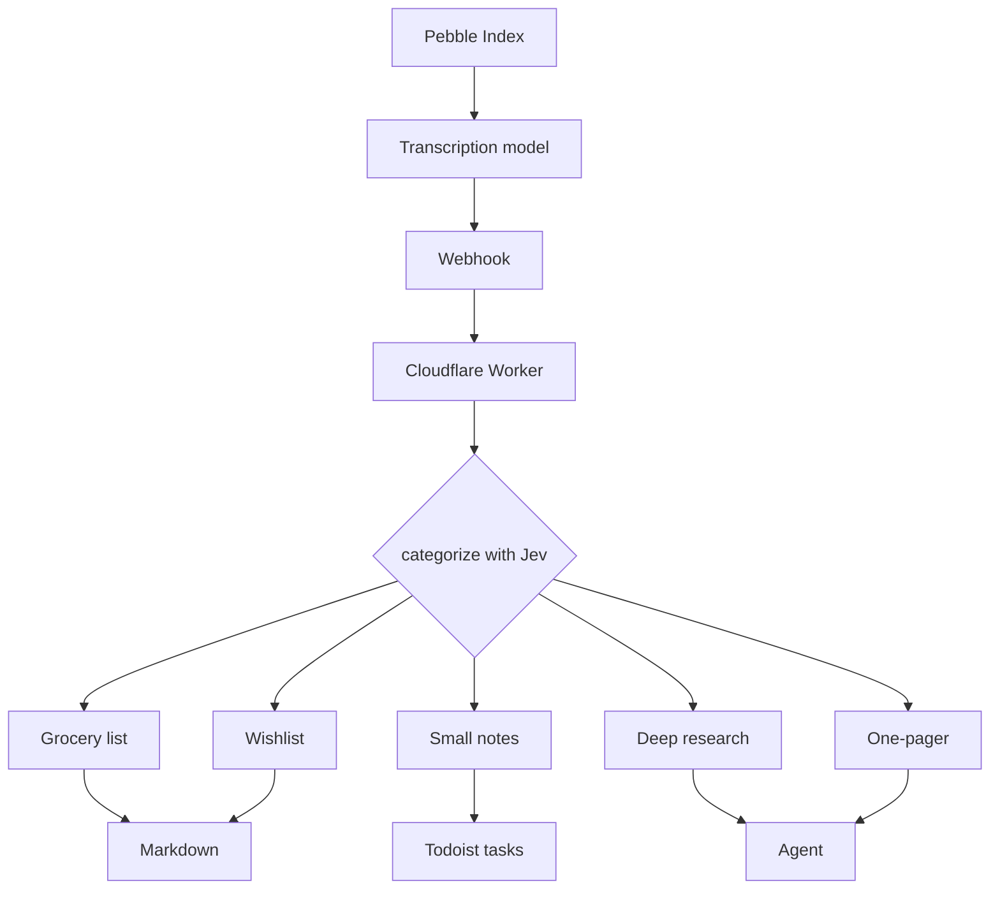

I've been using a [Pebble Index](https://repebble.com/index) for the last couple of months and while I dislike the fact it's a consumable, it's been a very handy little piece of technology. Short notes and thoughts easily drafted down is something I really do like. The app isn't really my jam however, but they do offer an option to call a webhook! 

So, my first thing I wanted it better routing for my notes. Here are a couple of example I've been using it for: 

- Grocery lists
- Wishlist items
- Small notes
- Topics for an LLM to do deep research on
- Small one-page artifact instructions that could be helpful to me in a situation
- And more like daily notes etc, etc...

In the end I ended up using Cloudflare and Jev for a proper way of routing messages:

I was already using a Cloudflare worker for [Kukuroo](https://github.com/saiday/kukuroo) to send myself push notifications for stuff (including agents). I've extended that to add the webhook and classifier as well as an option to redirect to urls. This allows agents to create deep research and one-pager artifacts, upload them and send them trough a push notification back to me... 

Pretty handy if you ask me! Need a brief for an organisation you're about to help? Get a report back in 15 minutes with all the information that might be useful! Want to explore a topic, create a one-pager artifact with interactive explanations starting from just a question asked to the Pebble Index! 